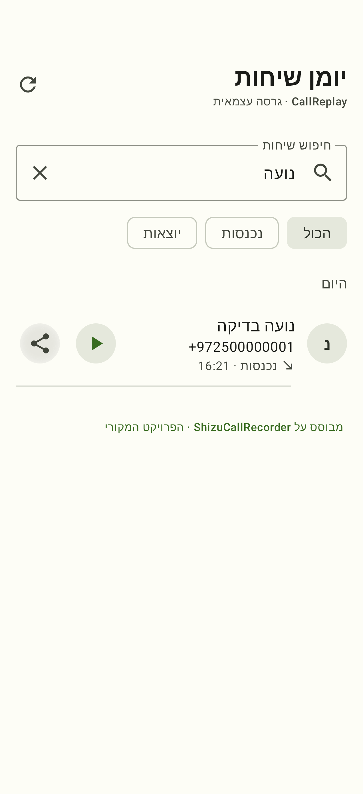

# CallReplay

An Android call recorder with a phone-style call log: find a conversation, play its recording,
or share it directly from the list. Includes Hebrew UI and right-to-left layouts.

**Independent fork of [ShizuCallRecorder](https://github.com/kitsumed/ShizuCallRecorder),
originally created by kitsumed (Med).** CallReplay uses its own name, icon and package ID:
`io.github.uriel1010.callreplay`.

[Download CallReplay](https://github.com/Uriel1010/CallReplay/releases/latest)
· [Setup guide](docs/SUPPORT.md)
· [Report an issue](https://github.com/Uriel1010/CallReplay/issues)

## Features

- Opens directly to **Call logs**, with caller details and recordings grouped by date.
- Searches by contact name, phone number or filename; filters incoming and outgoing calls.
- Plays, pauses and seeks within recordings without leaving the call log.
- Shares compatible AAC-LC `.m4a` attachments through the Android Sharesheet,
  including recordings originally saved as Opus or AMR. Original recordings stay unchanged.
- Finds existing recordings in your chosen folder, including nested folders.
- Supports Hebrew, RTL layouts, light and dark themes, and adaptive navigation.
- Retains upstream recording controls, automatic recording rules, audio sources and codecs.
- Checks GitHub for updates on request, with optional daily checks and verified downloads.

The call log shows **recorded calls**, rather than every entry in the system Phone app.
Older files without saved caller metadata appear by filename.

Sharing prepares a separate audio file locally before opening the Sharesheet. You can cancel
preparation. Completed attachments remain available for delayed imports; attachments older than
seven days are removed the next time you share. These copies are excluded from Android backups.



*Actual device screenshot using synthetic caller details.*

## Install and set up

1. Download the APK ending in `-release.apk` from the
   [releases page](https://github.com/Uriel1010/CallReplay/releases).
2. Install the APK, allowing installation from your browser or file manager if Android asks.
3. Open CallReplay and follow the initial setup. To record new calls, start
   [Shizuku](https://github.com/thedjchi/Shizuku), grant the requested permissions, and choose
   a recording folder. Existing recordings can be browsed without completing recording setup.
4. For Hebrew, use **Settings → Language → עברית**, or leave the language on system default
   when your phone uses Hebrew.

Production releases use a dedicated release signing key and are non-debuggable,
with code and resource shrinking enabled. The public signing lineage supports
in-place migration from the original CallReplay debug preview. Preserve your
installed app and its data; do not uninstall to resolve a signing error.

For future updates, open **Settings → About → Check for updates**. Automatic
checking is optional and initially off. Alternatively, add this repository in
[Obtainium](https://github.com/ImranR98/Obtainium). Both methods use the same
GitHub release APK. See [updates, privacy and signing](docs/updates.md).

Android 11+ is the installation minimum. Recording support depends on Android version, device
manufacturer, audio source and Shizuku. See the [setup and compatibility guide](docs/SUPPORT.md).
VoIP and Wi-Fi calling support is best effort. Test recording on your own device before relying on it.

## Hebrew and accessibility

Hebrew text covers call logs, settings, setup, notifications, updates and
accessibility labels. Phone numbers and playback times keep their left-to-right ordering.
Date headings follow the app language. Brand names, technical identifiers and the original
nontranslatable legal disclaimer remain in their source language.

## Build and test

The project uses Java 17, Gradle 9.8.2, Android SDK platform 37 and build tools 36.0.0.
The upstream project does not track the Gradle wrapper scripts or wrapper JAR, so install
Gradle 9.8.2 first or generate a wrapper locally.

On Linux with a systemd user session, use the included script to keep local builds bounded:

```sh
export JAVA_HOME=/path/to/jdk-17
export ANDROID_HOME=/path/to/android-sdk
export CALLREPLAY_GRADLE=/path/to/gradle-9.8.2/bin/gradle
bash scripts/build-local-limited.sh :app:assembleDebug :app:assembleDebugAndroidTest :app:lintDebug
```

The script requires at least 4 GiB available memory and limits the build to 2.5 GiB memory,
no build swap, one Gradle worker and two CPUs worth of processing. It requires systemd user scopes.
On other build environments, configure equivalent resource limits before invoking Gradle.

Install and run the device tests:

```sh
adb install -r app/build/outputs/apk/debug/app-debug.apk
adb install -r app/build/outputs/apk/androidTest/debug/app-debug-androidTest.apk
adb shell am instrument -w io.github.uriel1010.callreplay.test/androidx.test.runner.AndroidJUnitRunner
```

The reference UI passed **33 instrumentation tests** on a physical CPH2747: default launch behavior,
playback lifecycle, seeking, metadata persistence, search, filters, share intents, Hebrew text,
RTL phone numbers, and landscape with large text. That build's lint completed with zero errors and 127 warnings.
Each release's notes identify its own verification and any device-testing limitations.
These checks use synthetic contacts and audio; they do not establish call-capture compatibility
across devices. See [implementation and verification notes](docs/recording-history.md).

## Contributing and releases

Please report CallReplay issues in [this repository](https://github.com/Uriel1010/CallReplay/issues),
including your device, Android version and steps to reproduce. Remove private caller details
before attaching logs. See [CONTRIBUTING.md](CONTRIBUTING.md) for the inherited contribution guide.

Published releases include an APK, SHA-256 checksum and release notes. Matching source is
available through the release tag and GitHub's source archives.

## Credits and license

CallReplay builds on [ShizuCallRecorder](https://github.com/kitsumed/ShizuCallRecorder)
by **kitsumed (Med)** and its contributors. Original copyright notices and project history are
preserved. Fork implementation was assisted by OpenAI Codex. You can support the original
author through [GitHub Sponsors](https://github.com/sponsors/kitsumed).

Licensed under [GNU GPL v3 or later, with additional terms under Section 7](LICENSE).
CallReplay is an independent modified version and is not an official upstream release.
The [inherited project overview](README.upstream.md) is retained for reference.

Recording calls may require consent or notification under applicable law. The app does not
obtain consent or notify participants for you. Read the in-app disclaimer and
[upstream usage notes](docs/SUPPORT.md) before recording.
